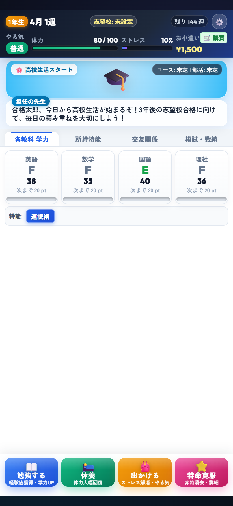
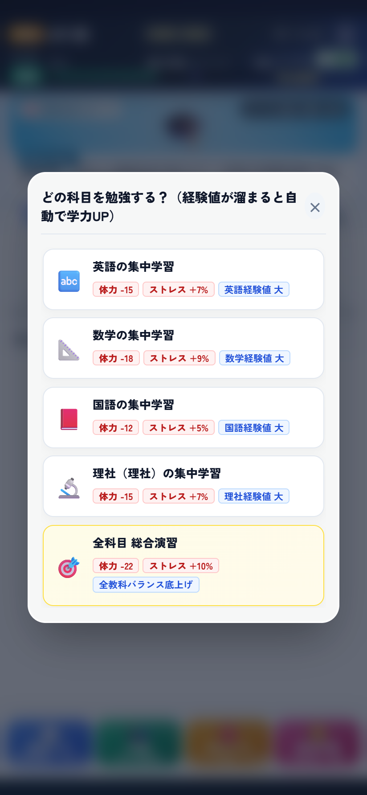
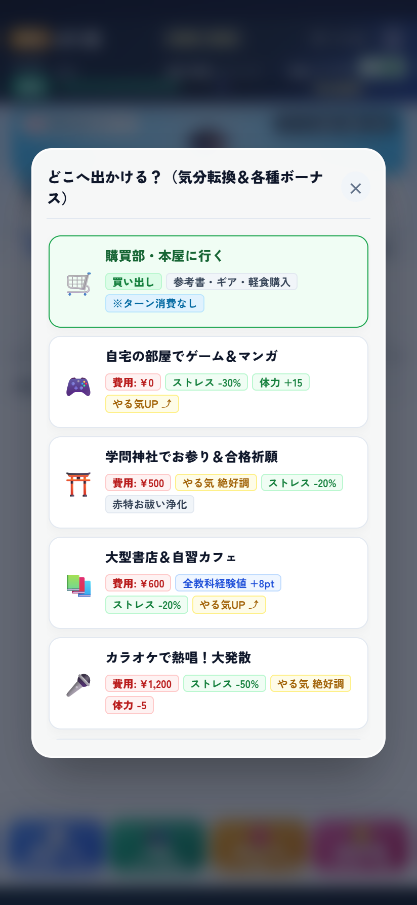

# 🎓 高校生活・大学受験 育成シミュレーションゲーム『SUCCESS』

[-success?style=for-the-badge)](https://developer.mozilla.org/ja/docs/Web/JavaScript)

高校1年4月から高校3年3月までの**全144週間（ターン制）**にわたり、高校生活・部活・勉強・息抜きを通じて学力とコンディションをマネジメントし、志望大学現役合格を目指すブラウザ育成シミュレーションゲームです。

---

## 1. 🖼 プレイ画面イメージ

  
  
<strong>▲ スマートフォン全画面（100dvh）に最適化されたメイン育成画面</strong> 
  （体力・ストレス・やる気・所持金・5教科ゲージ・特殊能力が一目で把握できる直感UI）

 

| 📖 勉強メニュー（統一カラータグ） | 🎒 出かけるメニュー（気分転換） | 🛒 購買部・本屋ショップ |
| :---: | :---: | :---: |
|  |  |  |
| 🔴消費 / 🟢軽減 / 🟡やる気 / 🔵経験値 | 息抜き・合格祈願・神童くん交友 | 参考書・勉強ギア・軽食の購入 |

---

## 2. 🌐 プレイ用URL

👉 **[ゲームをプレイする（Webブラウザで直接起動）](https://success.xcangcheng.workers.dev/)**  
- **ホスティング環境**: Cloudflare Workers / Pages
- **推奨環境**: PC（Chrome / Edge / Safari）および スマートフォン（iOS Safari / Android Chrome）
- **インストール不要**: 外部アセットDL待ちや重いバンドル読み込みが一切なく、アクセス後0秒で即座にプレイ可能です。

---

## 3. 🎮 ゲームの概要と操作方法

### 3.1 ゲームの概要
プレイヤーは高校生となり、限られた体力・やる気・ストレス・所持金をやりくりしながら、日々の学習や息抜きを行います。  
定期テスト、定期模試（マーク・記述・冠模試）を経てリアル偏差値（35〜75）を高め、新課程1000点満点の共通テスト、私大併願、そして国公立前期・後期日程の入試バトルを突破して第一志望大学への合格を目指します。

### 3.2 育成サイクルと基本コマンド
| コマンド | アイコン | 主な効果・役割 |
| :--- | :---: | :--- |
| **勉強する** | 📖 | 英語・数学・国語・理科/社会・副教科（情報I）を選択して学習。経験値を獲得して学力ランク（G〜S）と偏差値を向上（※体力を消費、ストレスが増加）。 |
| **出かける** | 🎒 | 自宅・神社（合格祈願）・書店・カラオケ・交友（友人や神童くん）へ外出。ストレスを大幅解消し、やる気を上昇。 |
| **休養する** | 🛌 | 自宅でしっかり休み、体力を大きく回復。 |
| **購買部へ** | 🛒 | 毎月支給されるお小遣いで参考書・勉強ギア・栄養ドリンク・お守りを購入・使用。 |
| **特命克服 / 状態**| ⭐ | 現在のパラメータ、5教科の学力・偏差値、習得した特殊能力、歴代OB名簿を閲覧。 |

### 3.3 コンディション管理の3大パラメータ
- **体力（0〜100）**: 勉強すると減少。ゼロになると「過労・体調不良」になり、数週間の行動不能や能力低下ペナルティが発生。
- **ストレス（0〜100）**: 勉強を続けると蓄積。「出かける」や軽食アイテムで解消しないと、やる気の急激な低下やサボり癖につながる。
- **やる気（絶不調 / 不調 / 普通 / 好調 / 絶好調）**: 行動効率（獲得経験値）や模試・試験バトルのクリティカル率に直結。

---

## 4. 🛠 使用技術・開発環境

| カテゴリ | 採用技術・ツール | 選定理由・役割 |
| :--- | :--- | :--- |
| **フロントエンド言語** | HTML5 / CSS3 / JavaScript (ES6+ Vanilla) | フレームワーク依存によるオーバーヘッドやビルド遅延を排除し、ブラウザ本来の高速な実行性能を最大限に引き出すため。 |
| **オーディオエンジン** | Web Audio API (プログラマブルシンセ) | MP3/WAVなどの外部音声ファイルを一切読み込まず、オシレーター（発振器）とゲイン制御でBGM 3曲＋SEを完全自作リアルタイム合成。 |
| **データ永続化** | Web Storage API (localStorage) | 毎ターン終了時のオートセーブ、中断再開、および卒業生の「歴代OB名簿」の無制限ローカル保存。 |
| **インフラ / デプロイ** | Cloudflare Workers / Pages | エッジ配信によるグローバル超高速レスポンスと、Gitプッシュ連動のCI/CD自動デプロイパイプラインの構築。 |
| **AIペアプログラミング** | Google Antigravity | 仕様策定、複雑なゲームバランスの試算、E2E自動UIテストスクリプトの作成、およびリファクタリングの共同推進。 |
| **バージョン管理** | Git / GitHub | 機能・改修単位の細やかなコミット管理と、開発履歴（DEVLOG）の体系的ドキュメンテーション。 |

---

## 5. 💡【重要】技術的なこだわり・設計の工夫

### ① 外部ライブラリゼロ（Zero Dependency）のピュアフロントエンド設計
- npmパッケージやReact/Vue/jQuery等の外部ライブラリを一切導入せず、**HTML/CSS/Vanilla JSのみで約4,200行のゲームロジックを完結**させました。
- これにより、ライブラリのバージョン衝突や脆弱性リスクを根本から排除。初回アクセス時のJavaScriptパース時間が極小化され、低スペック端末でも60fpsの滑らかな動作を実現しています。

### ② Web Audio API による完全自作の「ゼロアセット音響エンジン」
- 通常のWebゲームでは数十MBのMP3/WAV音源ファイルが必要ですが、本作は**音声アセット容量ゼロ**を達成しています。
- ブラウザ標準のオシレーター（`OscillatorNode`）とエンベロープゲイン（`GainNode`）を用い、以下をリアルタイム波形合成しています：
  - **日常BGM**: 温かみのある4和音コード進行とアルペジオ
  - **試験バトルBGM**: 緊張感を煽るファストテンポなベースラインとドラムビート風ホワイトノイズ
  - **タイトルBGM & 各種効果音**: クリック音、正解チャイム、ファンファーレ等
- モバイルブラウザ特有の「User Gesture ポリシー（画面タップ前の音声再生ブロック）」を考慮し、初回タップでの `AudioContext.resume()` 自動復帰機構を設計しました。

### ③ モバイルファーストの「1画面ピタ止め＆二重スクロール防止」UI設計
- スマートフォンの全画面表示に対応するため、`height: 100vh` ではなく動的ビューポート単位 **`height: 100dvh`** を採用。iOS Safari / Androidのアドレスバー伸縮に追従させました。
- メインゲーム画面は親コンテナで `overflow: hidden` に固定し、モーダル内部のリスト領域のみに `overflow-y: auto; -webkit-overflow-scrolling: touch;` を適用。
- これにより、スマホ操作時にありがちな「画面全体が引っ張られてガタつくバウンス現象」を完全防止し、ネイティブアプリ同様の快適な手触り（Game Juice）を実現しました。

### ④ 統一カラー効果タグ（Visual Badge System）による直感的UX
- 勉強コマンド、購買部アイテム、出かける選択肢など、すべての行動選択カードに**統一された色付き効果タグ**を導入しました：
  - 🔴 **赤**: 体力消費（コスト）
  - 🟢 **緑**: 体力回復・ストレス軽減・消費緩和
  - 🟡 **黄**: やる気上昇・メンタル向上
  - 🔵 **青**: 学力経験値の獲得
- 所持している参考書や装備ギア（低反発クッション、耳栓など）の効果が、勉強メニュー内の体力消費数値やバッジタグへ**リアルタイムに動的連動**する仕組みを構築しました。

---

## 6. 🚀【重要】開発中に直面した課題と解決策（リファクタリング＆バグ修正）

就活面接でも説明可能な、開発プロセスにおける主要な3つの技術的課題と解決エピソードです。

### 課題1: iOS Safari 特有の動的ツールバーによるUI見切れ・二重スクロール問題
- **【状況・問題】**  
  スマホ実機でテストした際、Safariの下部アドレスバーが展開した際にフッター操作ボタンが隠れる問題や、購買部モーダルを開いた際に「モーダルの背景ごと画面全体が縦スクロールしてしまう」というUIの破綻が発生しました。また、文字数が多い選択肢カードでテキストの2行目が見切れる不具合も散見されました。
- **【分析とアプローチ】**  
  CSSの静的指定（`100vh` や固定 `height: 52px`）が原因であることを特定。実機のレンダリング挙動を網羅的にテストしました。
- **【解決策】**  
  1. `height: 100dvh` と `env(safe-area-inset-bottom)` を組み合わせて動的セーフエリア追従を実装。
  2. カード要素を `min-height: fit-content` 化し、動的な文字量に柔軟に適応するレイアウトへ刷新。
  3. モーダル表示時に背面のスクロールコンテキストを分離し、モーダル内部リスト要素だけがスクロールする厳密なレイアウト設計を実施。
- **【結果】**  
  iPhone SE（小型端末）から最新の大型端末まで、画面がピタッと1画面に収まり、一切の見切れや不自然なスクロールが発生しない堅牢なレスポンシブUIを確立しました。

---

### 課題2: ゲーム内経済とアイテム連打によるゲーム難易度の崩壊（インフレ問題）
- **【状況・問題】**  
  購買部システムを導入後、「お小遣いが貯まりやすく、ドリンクやお菓子を毎ターン大量購入・連打することで、体力・ストレスのマネジメントが形骸化し、ゲームが過度に簡単になってしまう」という難易度崩壊に直面しました。
- **【分析とアプローチ】**  
  単純にアイテムの所持上限（スタック制限: 最大3個など）を設けると、「安価なアイテムを買いだめできないストレス」や「マイバッグUIが窮屈になる」というユーザー体験の悪化を招くことが分かりました。
- **【解決策】**  
  1. **所持上限の完全撤廃**: アイテムは何個でも自由にストック・買いだめ可能に変更。
  2. **1週1回使用制限の導入**: 消耗品アイテムの使用回数を「1週（1ターン）につき1個まで」に制限。
  3. **お小遣い経済の再調整**: 初期所持金を¥1,500、月額支給を学年に応じて¥1,500〜¥2,500にデフレ調整。
- **【結果】**  
  「アイテムをまとめ買いしてストックする快感」を維持しつつ、「1ターンに1回しか使えないため、どのタイミングで何を使うか」という戦略性が生まれ、シミュレーションゲームとしての骨太なゲームバランスを両立させました。

---

### 課題3: Web Audio API における自動再生制限とタイマードリフト対策
- **【状況・問題】**  
  外部音源を使わないプログラマブルシンセを実装した際、iOS Safariのセキュリティポリシーにより「ユーザー操作（User Gesture）がないと音声がミュート状態のまま再生されない」という問題が発生しました。また、スマホがバックグラウンドに移行した際にBGMの拍（テンポ）が狂う「タイマードリフト」が生じました。
- **【分析とアプローチ】**  
  ブラウザの `AudioContext` ライフサイクルと、`setInterval` のバックグラウンド間引き動作が原因でした。
- **【解決策】**  
  1. 画面の初回タッチ/クリックイベントをフックし、`audioCtx.state === 'suspended'` の場合に `audioCtx.resume()` を呼び出すアンロックハンドラを実装。
  2. BGMのシーケンサーを単純な `setTimeout` ではなく、Web Audio API 内部の高精度タイムスタンプ（`audioCtx.currentTime`）に同期して先回りスケジュールする設計に変更。
- **【結果】**  
  端末やOSを問わず、クリアな音質と正確なテンポでBGM/SEが安定して鳴り響く強固な音響システムを実現しました。

---

## 7. 📜 開発履歴（DEVLOG）

本プロジェクトの開発過程（アーキテクチャの変遷、コミット履歴ごとのマイルストーン、詳細な日付別開発日誌）は、リポジトリ内の [`DEVLOG.md`](DEVLOG.md) にて**最新の日付順**で克明に記録されています。

👉 **[詳細な開発日誌を見る（DEVLOG.md）](DEVLOG.md)**

---

## 8. 👤 作者・リポジトリ情報
- **開発者**: [koeita](https://github.com/koeita)
- **リポジトリ**: [https://github.com/koeita/SUCCESS](https://github.com/koeita/SUCCESS)
- **公開URL**: [https://success.xcangcheng.workers.dev/](https://success.xcangcheng.workers.dev/)
